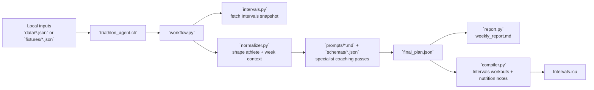
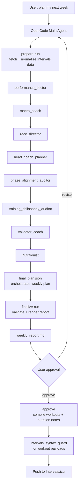

# Triathlon Agent

Local, on-demand triathlon coaching workflow for planning one training week at a time.

The system is built around prompt files plus a lightweight Python execution layer.

## System Diagram



In practice the code does four things:

- collect athlete inputs plus Intervals history
- normalize that into one planning snapshot
- produce a weekly plan and report through the specialist prompt chain
- compile and push workouts only after explicit approval

## Public Repo Notes

This repository is safe to commit publicly when you keep these local-only files out of git:

- `.env`
- `data/athlete_profile.json`
- `data/weekly_checkin.json`
- `data/race_calendar.json`
- everything under `runs/`

The committed repo should contain:

- `triathlon_agent/` runtime code
- `prompts/` and `schemas/` planning contracts
- `fixtures/` deterministic mock data
- `tests/` verification
- `data/*.template.json` starter inputs
- docs such as `README.md`, `DESIGN.md`, and `OPENCODE.md`

The intended production workflow is:

- you say `plan my next week` to OpenCode
- the OpenCode main agent becomes the orchestrator
- it fetches a fresh Intervals snapshot before any coaching reasoning
- it summarizes last week from Intervals, asks only targeted follow-up questions, and then drafts the week
- it calls the specialist prompt files one by one
- the Python helper layer fetches Intervals data, stores artifacts, validates files, compiles workouts, and pushes only after approval

The Python layer can also run a deterministic stub workflow for tests and fixture-backed dry-runs.

It can run in:

- `mock` mode with fixtures and dry-run write-back
- `live` mode against Intervals.icu using a personal API key

It is intentionally simple:

- pull athlete data
- normalize it
- let the OpenCode main agent run specialist prompts in order
- generate a weekly report
- require approval before write-back
- compile approved workouts into Intervals.icu workout syntax or structured calendar events
- compile separate nutrition note events for meaningful days
- push workouts only after approval

## Folder structure

- `prompts/` agent prompts and master prompt for the OpenCode main agent
- `schemas/` JSON contracts for agent outputs and the final plan
- `data/` editable templates for athlete profile, weekly check-in, and optional race-calendar supplements; your filled-in `.json` files stay local
- `fixtures/` mock Intervals data and example local inputs
- `triathlon_agent/` helper code for preparation, validation, compilation, adapters, and deterministic stub mode
- `tests/` automated workflow tests
- `runs/` local run artifacts generated by the CLI

## Requirements

- Python 3.11+
- no third-party Python dependencies required

## Configuration

1. Copy `.env.example` to `.env` if you want live Intervals access.
2. Create local input files from the templates:

```bash
cp data/athlete_profile.template.json data/athlete_profile.json
cp data/weekly_checkin.template.json data/weekly_checkin.json
cp data/race_calendar.template.json data/race_calendar.json  # optional
```

3. Fill in your local `data/*.json` files. They are intentionally gitignored.
4. For deterministic dry-runs, you can skip local data entirely and use `fixtures/*.json`.

Relevant environment variables:

- `TRIATHLON_AGENT_MODE=mock|live`
- `INTERVALS_API_KEY=...`
- `INTERVALS_ATHLETE_ID=0`
- `TRIATHLON_AGENT_RUNS_DIR=runs`

## Weekly check-in fields

Important `data/weekly_checkin.json` fields:

- `open_water_mode`: `false` keeps pool-season swim constraints active; `true` lets the planner relax those seasonal swim constraints
- `available_hours_override_min` / `available_hours_hard_cap_min`: hours you have this week, in minutes; these bind (`finalize-run` rejects a plan above them). The profile's typical hours stay a soft reference
- `double_session_capacity_by_day`: optional per-day double-session guidance for the coming week
- `time_caps_by_day`: optional per-day time caps in minutes for the coming week; these do bind
- `red_flags`, `illness_symptoms`: chest pain, palpitations, disproportionate breathlessness, dizziness or fever stop training and send you to a doctor; above-the-neck symptoms alone allow easy sessions
- `pain_scores`: 0-10 per body part (≥ 3 is a niggle, ≥ 5 means no impact on that area)
- `sleep_quality`, `work_stress`, `missed_session_reasons`, `upcoming_events`, `race_debrief`
- `subjective_readiness`, `current_motivation`: leave `null` when unknown; a blank answer is never read as "fine"

Answer the post-fetch check-in with `record-checkin` (see below); its answers are merged into the run and the snapshot is re-normalized before planning.

## Races come from your Intervals calendar

Races, priorities (A/B/C) and dates come only from Intervals.icu RACE events. The optional local race calendar can only add notes to a race that is already on the Intervals calendar; it never adds a race or changes its date, name or priority. Entries it cannot match are listed in `race_calendar_warnings`. `data/athlete_state.json` keeps history only, never the priority race.

Wellness baselines for HRV, resting HR, and sleep are derived from Intervals.icu wellness history whenever enough data exists. Manual baseline fields in `data/athlete_profile.json` are optional fallback overrides only.

The permanent athlete profile now separates:

- `hard_constraints`
- `soft_preferences`
- `phase_preferences`
- `decision_policy`

The coaching philosophy is explicitly organized around:

- `Joe Friel` for periodization and race-phase structure
- `Jack Daniels` for run taxonomy
- `Andrew Coggan` for bike taxonomy
- `prompts/training_intensity_doctrine.md` for intensity and progression:
  - pyramidal distribution by default
  - quality-session count from the readiness allowance and HRV gate
  - underload detection
  - time-in-zone progression ladders, including VO2max / I work and ultra-trail uphill threshold

There is no session library: the head coach designs every session. Deterministic support lives in:

- `triathlon_agent/training_load.py`, which feeds `normalized_snapshot.training_load`:
  - CTL ramp and TSB (thresholds scale with CTL)
  - 28-day three-zone distribution (power zones for rides when available)
  - quality frequency
  - HRV gate (`stale` when HRV is more than 2 days old)
  - eFTP trend
  - underload markers, with a physiological veto (`explained_physiological`)
  - `return_from_break`: a 50 → 60 → 75 → 90% re-entry ramp after 7+ days off
  - run-specific ACWR and `week_caps` for run km, minutes, descent and the long run
  - `daily_signals`: a 1–3 day resting-HR / HRV early warning
  - `overreaching` (functional vs non-functional) and `efficiency_trend`
- `normalized_snapshot.activity_note_flags`: pain, illness and red-flag words from activity descriptions and comments (EN + NL)
- `triathlon_agent/progression.py`, which feeds `normalized_snapshot.progression`: the last completed dose per ladder family and the next rung.
- `triathlon_agent/plan_audit.py`, run by `finalize-run`: a deterministic check of `final_plan.json` against the doctrine. It writes `coaching_audit` into the final plan and a `## Coaching Audit` section at the top of the report. It warns but never blocks approval. It flags:
  - under-dosed green weeks
  - underload not addressed
  - quality above the allowance
  - missing `progression` objects
  - no rung progression on the last completed dose
  - quality on consecutive days
  - almost-all-easy weeks, and weeks above the 30% intensity ceiling
  - a missing scheduled threshold test
  - quality inside a recovery week
  - running above `run_load.week_caps` (run km / minutes ~+10%, descent ~+15%), long runs above the cap, and weeks that ignore `return_from_break`
  - more than two progressing elements, or more than one run-impact element (the progression budget)
  - heavy leg strength before a key session, and hard work across the week boundary
  - quality within 72 h before a B-race, hard work after a race, and over-deep tapers
  - running or descending with a reported pain score of 3/10 or more

All thresholds live in `triathlon_agent/coaching_limits.py`, shared by the audit, the validator and the stub head coach.

## Threshold testing

The agent schedules threshold tests itself so FTP, threshold pace, and LTHR stay correct (`prompts/threshold_testing_doctrine.md`, `triathlon_agent/threshold_testing.py`):

- a recovery week ends with a test (Friel "rest & test") only when a discipline relevant to the A-race is due: a trail block tests the run, and the bike only when the FTP is stale or overdue and bike targets are prescribed; no tests in a return-from-break week
- when the set FTP is more than 10% above a confident eFTP, the interim update is proposed with `apply: true` (still pushed only after you approve the week); when eFTP is more than 5% above the set FTP, targets are scaled up
- at least 42 days between tests of the same discipline (28 with an early trigger such as FTP vs eFTP drift above 5%); 84+ days is overdue
- no tests within 21 days of an A-race or 7 days of a B-race, with red readiness, shortly after illness, or (run) with a reported niggle
- a recent flat road race of 10k or longer counts as the run test
- bike protocol: `coggan_20` (20' x 0.95) by default, `friel_30` (30' TT, final-20' HR = LTHR) as option B; run protocol: Friel 30' TT
- set the default in `athlete_profile.json` under `threshold_testing.bike_protocol`, or override one week with `"bike_test_protocol": "friel_30"` in the weekly check-in
- after a test, `prepare-run` reads its laps from Intervals and proposes new values in the report; `approve` pushes the confident ones to Intervals sport settings and records the test in `data/athlete_state.json`

## OpenCode-native workflow

This is the intended production flow.

The exact `plan my week` behavior contract is documented in `PLAN_MY_WEEK_SPEC.md`.

1. In OpenCode, say something like:

```text
plan my next week
```

2. The OpenCode main agent should internally run:

```bash
python3 -m triathlon_agent.cli prepare-run \
  --mode live \
  --athlete-profile data/athlete_profile.json \
  --weekly-checkin data/weekly_checkin.json
```

The freeform phrase `plan my week` should prepare the run and stop before drafting. The required post-fetch check-in questions are written into `runs/<run_id>/run_context.json`, and the week must not be drafted until those questions have been asked and answered.

3. The main agent reads:

- `runs/<run_id>/normalized_snapshot.json`
- `runs/<run_id>/run_context.json`
- `prompts/*.md`
- `schemas/*.json`

4. Before drafting, the main agent must:

- verify the fetched Intervals snapshot is fresh enough for planning
- summarize the prior week from the fetched activities and wellness
- ask only for subjective feedback and coming-week constraints that Intervals cannot know
- write the answers to a JSON file and record them, which re-normalizes the snapshot without a new fetch:

```bash
python3 -m triathlon_agent.cli record-checkin runs/<run_id> answers.json
```

In live mode `finalize-run` refuses to run before the check-in is recorded (override with `--allow-missing-checkin`).

5. The main agent calls each specialist and writes:

- `runs/<run_id>/agent_outputs/performance_doctor.json`
- `runs/<run_id>/agent_outputs/macro_coach.json`
- `runs/<run_id>/agent_outputs/race_director.json`
- `runs/<run_id>/agent_outputs/phase_alignment_auditor.json`
- `runs/<run_id>/agent_outputs/training_philosophy_auditor.json`
- `runs/<run_id>/agent_outputs/head_coach_planner.json`
- `runs/<run_id>/agent_outputs/validator_coach.json`
- `runs/<run_id>/agent_outputs/nutritionist.json`
- `runs/<run_id>/final_plan.json`

### Agent Flow



6. The main agent validates and renders the report with:

```bash
python3 -m triathlon_agent.cli finalize-run runs/<run_id>
```

7. You review `runs/<run_id>/weekly_report.md` and approve or request changes.

8. After approval, the main agent pushes workouts with:

```bash
python3 -m triathlon_agent.cli approve runs/<run_id> --mode live
```

Approval is bound to the exact `final_plan.json` (sha256): if the plan changes after approval, `approve` refuses to push and re-finalizing resets the approval to pending. Before pushing, `approve` compares the live calendar with what it pushed last time; events you edited or moved in Intervals are skipped and listed in `edited_events.json` (force with `--overwrite-edited`). Nothing is ever deleted.

When the week goes off the rails mid-week (illness, a bad night, travel), re-plan only the remaining days in a new linked run:

```bash
python3 -m triathlon_agent.cli adjust-week runs/<run_id> --from YYYY-MM-DD --reason "sick since Tuesday" --mode live
```

It fetches fresh data, writes `adjustment_context.json` (done so far vs planned), seeds the remaining days as the draft, and needs its own `finalize-run` and approval. `approve` then pushes only the days from `--from` on.

If you want to inspect the exact helper flow, see `prompts/master_prompt.md` and `runs/<run_id>/run_context.json`.

After approval the system can push:

- structured workouts
- swim placeholders where appropriate
- separate `Nutrition Targets` note events only on days with meaningful guidance

## Deterministic stub workflow

Mock draft plan using the built-in deterministic stub agents:

```bash
python3 -m triathlon_agent.cli plan-week \
  --mode mock \
  --athlete-profile fixtures/athlete_profile.json \
  --weekly-checkin fixtures/weekly_checkin.json
```

Freeform trigger style:

```bash
python3 -m triathlon_agent.cli "plan my week" \
  --mode mock \
  --athlete-profile fixtures/athlete_profile.json \
  --weekly-checkin fixtures/weekly_checkin.json
```

This freeform trigger resolves to `prepare-run`, not `plan-week`, so the main agent can review the snapshot and ask the required weekly check-in questions before drafting.

Approve an existing draft and run compile + push in mock mode:

```bash
python3 -m triathlon_agent.cli approve runs/<run_id> --mode mock
```

End-to-end dry-run in one shot:

```bash
python3 -m triathlon_agent.cli plan-week \
  --mode mock \
  --athlete-profile fixtures/athlete_profile.json \
  --weekly-checkin fixtures/weekly_checkin.json \
  --auto-approve \
  --dry-run
```

Live mode against Intervals.icu using the deterministic stub workflow:

```bash
python3 -m triathlon_agent.cli plan-week \
  --mode live \
  --athlete-profile data/athlete_profile.json \
  --weekly-checkin data/weekly_checkin.json
```

Optional supplemental local race data if you want to enrich Intervals events with extra notes:

```bash
python3 -m triathlon_agent.cli plan-week \
  --mode live \
  --athlete-profile data/athlete_profile.json \
  --weekly-checkin data/weekly_checkin.json \
  --race-calendar data/race_calendar.json
```

Then approve the run:

```bash
python3 -m triathlon_agent.cli approve runs/<run_id> --mode live
```

## Run tests

```bash
python3 -m unittest discover -s tests -v
```

## Approval gate

- `plan-week` always creates `approval.json` with `pending` status unless `--auto-approve` is used.
- `prepare-run` always creates `approval.json` with `pending` status.
- compile and push never happen until the run is approved.
- even in `--auto-approve` mode, the system records the approval event before compilation.

## Notes

- Bike workouts are compiled with `%FTP` targets.
- Easy and aerobic-only runs are compiled with `HR` targets.
- Quality runs are compiled with `Pace` targets based on Intervals threshold pace.
- Strength sessions are pushed as `WeightTraining` workouts with structured notes.
- Swims can be pushed as simple `Swim` calendar events with minimal or empty workout text.
- Nutrition guidance can be pushed as separate daily `NOTE` events titled `Nutrition Targets`.
- Race events are pulled from Intervals calendar data when they are marked as `RACE_A`, `RACE_B`, `RACE_C`, or `TARGET`.
- In production, coaching reasoning is expected to come from the OpenCode main agent plus prompt files, not from the deterministic Python stubs.
- In production, `plan my week` should not ask you to manually recount completed sessions if live Intervals data has already been fetched.
- Run sessions should declare a Daniels type.
- Bike sessions should declare a Coggan level plus expected IF and estimated TSS.
- The weekly report includes a phase-alignment check and a training-philosophy check.
- The weekly report includes nutrition note previews and the write-back preview includes note counts.

## Assumptions

- Swim sessions are supported as planned calendar events, but the system still treats swim structure more lightly than bike or run structure.
- The source of truth for run pace targets is Intervals run sport settings.
- The source of truth for bike intensity targets is Intervals bike FTP.
- The source of truth for race scheduling is the Intervals calendar unless you provide optional supplemental local race notes.
- Weekday preferences are soft unless they are real access constraints such as club swims or pool hours.
- The compiler uses conservative, documented Intervals workout syntax.
